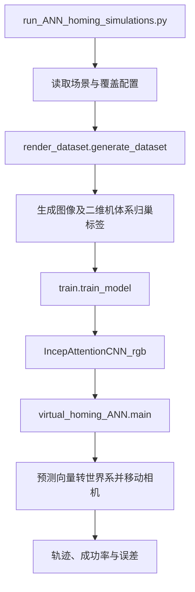

# 10 m 高度、30°下视相机视觉归巢实验：修改方案与代办清单

编写日期：2026-10-22；进度更新：2026-10-27。代码基线：`e1ef00b1e3636466c19e326b326811e43384a039`，另核对了工作区现有 Docker 构建与运行脚本。本文为持续更新的实施计划，未勾选项均为后续工作；已实施项的证据以各阶段报告为准。

实施进度：A1–A5 已完成，见[第一阶段报告](STAGE_01_BASELINE_REPORT.md)；B1–B6 已完成，见[第二阶段报告](STAGE_02_PIPELINE_REPORT.md)；C1–C8 已完成，见[第三阶段报告](STAGE_03_SCENE_REPORT.md)；D1–D8 的相机层与稳定取图已验收，见[第四阶段报告](STAGE_04_CAMERA_REPORT.md)；E1–E10 的八航向采集已验收，见[第五阶段报告](STAGE_05_CAPTURE_REPORT.md)；F1–F10 的分组划分与预处理已验收，见[第六阶段报告](STAGE_06_DATA_REPORT.md)。用户已确认 HFOV 30°、1024 方形图像、离地 10 m、固定下视随偏航旋转、动态稳定取图、每位置八航向和按位置分组保留原划分比例。训练、闭环与导航性能评测仍待 G–I。

后续场景调整：按用户要求，另生成 400×400 m 场地与 192 个简单几何路标，保留原三类平地诊断场景，见[几何路标预览说明](LANDMARK_SCENE_PREVIEW.md)。场地覆盖当前 25 m 起点与 50×2.5 m 动作预算，尚未进行训练或归巢。

## 1. 实验目标、边界与暂定条件

本阶段实现：在较大的 Isaac Sim 场景中，以约 10 m 的离地高度采集下视图像，使用 Bee-Nav 的视觉归巢网络学习二维归巢向量，再完成闭环归巢测试。首先验证视觉方法在新成像条件下是否成立，再确定可可靠工作的距离。

| 项目 | 本阶段约定 | 状态 |
| --- | --- | --- |
| 飞行高度 | 平坦地面上相机光心距地面 10 m，安装偏移暂为零 | 用户已确认 |
| 相机朝向 | 固定垂直下视，机体水平，图像上方对应机头，随偏航旋转 | 用户已确认 |
| 视场角 | **水平视场角 HFOV 30°**，理想针孔无畸变 | 用户已确认仿真定义 |
| 原始图像 | `1024×1024`、方形像素，对应 HFOV/VFOV 均为 30° | 用户已确认仿真参数，不等于实机标定 |
| 网络 | 当前主入口使用的 attention 网络，保持层、参数量和二维输出 | 沿用代码设置 |
| 训练与控制 | 优先保留原代码超参数；几何适配、评测修正单独记录 | 不混入新的网络或导航策略 |
| 场景规模 | 保留 100 m 诊断场景，已新增 400 m、192 路标场景 | 几何范围满足当前动作预算；导航能力待测 |
| 外出距离 | 暂不设为 100 m、500 m 等固定目标 | 等局部视觉范围及路径积分误差确定 |

这里的“第二步骤”按**局部视觉归巢阶段**理解：学习飞行采集数据 → 训练视觉网络 → 从指定位置开始闭环归巢。本阶段不接入完整外出/返航路径积分，不修改真实无人机 PX4/ROS 2 控制，也不引入强化学习、SLAM 或新网络结构。

原视觉仿真主要通过移动相机位姿产生观测，并非带电机、气动和飞控的完整无人机动力学仿真。本阶段沿用这种验证方式，结论应表述为“视觉归巢方法的相机运动学仿真结果”，后续再做动力学和实机验证。

## 2. 论文与代码给出的关键判断

### 2.1 大场景与长距离不能仅通过修改高度实现

论文的方法由学习飞行、外出、路径积分返航、局部视觉归巢组成。视觉网络主要记忆家附近的区域，长距离外出后依靠路径积分回到可视觉归巢的区域。论文中的长距离实验不能解释为“网络只看一帧就能从整条外出路线上的任意位置回家”。参见[论文正文与 Methods](https://doi.org/10.1038/s41586-026-10461-3)。

后续配置必须分开记录：

- `R_learn`：学习飞行位置到家的最大半径，应从实际轨迹计算。
- `R_visual`：在给定场景、航向和成功率标准下，实测得到的视觉归巢范围。
- `R_outbound`：外出轨迹距家的最大距离。
- `L_outbound`：外出轨迹累计长度；它与最大离家距离不同。
- `R_handoff`：路径积分转入视觉归巢时的位置误差范围。

本阶段测量 `R_visual`。完整流程后续应验证：路径积分返回点的大部分概率质量，例如原研究采用的 99% 要求，落在实测可归巢区域内；该区域可能不规则，不能只看一个平均半径。相关依据见[补充材料 SI-11](https://media.springernature.com/full/springer-static/esm/art%3A10.1038%2Fs41586-026-10461-3/MediaObjects/41586_2026_10461_MOESM1_ESM.pdf)。

### 2.2 10 m、30°的下视图像只看见较小地块

在水平地面、相机垂直下视的假设下：

```text
地面覆盖宽度 W = 2 × h_AGL × tan(HFOV / 2)
h_AGL = 10 m，HFOV = 30° → W ≈ 5.359 m
```

方形成像面若水平、垂直视场都是 30°，覆盖约 `5.36×5.36 m`。若采用 4:3 成像面且 HFOV 为 30°，VFOV 约为 22.73°，覆盖约 `5.36×4.02 m`。这些是几何计算，不是最大归巢距离。

相机世界坐标 `z=10` 也不一定等于离地 10 m：地形高度、屋顶和树冠都会改变可见表面的距离。例如相机位于 `z=10 m`，看到 `z=8 m` 的屋顶时，该平面上的覆盖宽度只有约 1.07 m。

**主要研究风险：**全景相机在较远位置仍可能看到学习过的地标；窄视场下视相机离开局部区域后，可能只看到从未见过的地面。重复草地、道路、屋顶还可能让不同位置产生相似图像。增加训练轮数无法消除缺乏信息造成的歧义。补充材料 SI-1～SI-5 分析了地标与朝向的可辨识条件，SI-8 的部分鲁棒性还依赖宽视场；这些条件必须在下视条件下重新验证，见[补充材料](https://media.springernature.com/full/springer-static/esm/art%3A10.1038%2Fs41586-026-10461-3/MediaObjects/41586_2026_10461_MOESM1_ESM.pdf)。

## 3. 全库模块与本次修改范围

以下相对路径均以 `Bee-Nav/` 为根。后文用 `SIM/` 简写 `visual_simulator_docker/CodeInsectInspired/`。

| 模块 | 作用与阅读结论 | 本阶段处理 |
| --- | --- | --- |
| [理论分析](../code_theoretical_simulation_analysis/) | 点地标观测、可辨识性、网络权重分析、路径曲折度及 SI 参数组；不是下视相机成像模型 | 保留，借鉴歧义诊断方法 |
| [路径积分噪声仿真](../path_integration_noise_simulation/) | 噪声、轨迹与学习归巢区域规模分析 | 暂不修改，预留返回误差接口 |
| [视觉仿真](../visual_simulator_docker/CodeInsectInspired/) | USD 场景、Replicator 采集、CNN 训练、相机闭环移动、结果分析 | 本阶段主要修改区 |
| [机器人网络训练](../robot_network_training/) | 实机数据标注、鱼眼/全景处理及 laptop/RPi 训练 | 核对坐标与标签定义；暂不修改 |
| [机载系统](../robot_onboard/) | 相机采集、ONNX 推理、ROS 2 学习飞行/归巢/避障、动捕转发 | 暂不修改；后续另做 NED 与相机安装适配 |
| `robot_onboard/homingdrone-ros2/src/px4_msgs/` | 随库附带的 205 个消息与 1 个服务接口，配套构建、CI 和文档 | 按接口契约核查；本阶段不改第三方消息定义 |
| `SIM/mushroom_body/`、snapshot、perfect-memory | 其他归巢基线、鱼眼投影、旋转匹配与 MNIST 容量实验 | 本阶段不迁移；以后比较时必须使用相同下视条件 |
| [硬盘运行说明](../visual_simulator_docker/DISK_BUILD.md) | 当前独立 Docker 服务、ext4 存储文件、源码绑定挂载 | 继续使用，无需为普通 Python 修改重建镜像 |

审阅覆盖第一方 Python 实现、配置、入口、分析脚本和文档，并核对论文全文及 49 页补充材料。二进制 USD、权重、图像及下载资产不能按源代码逐行阅读；本次没有把所有 USD 打开渲染，也没有重新训练验证。场景真实尺寸、树冠/屋顶高度及资源性能仍须通过后续几何与运行检查确定。配置中的私密内容不应进入实验文档或清单。

## 4. 当前运行的真实基线：先冻结，再适配

### 4.1 主调用链



当前入口的 `mode="variant"`，顺序使用 urban、warehouse、park、greenhouse、courtyard 五个已有场景，不是 README 描述的默认十个随机森林。`generate_environments` 和 `num_locations` 在这个模式下不负责生成这些场景。

### 4.2 要保留和要明确记录的设置

| 项目 | 当前代码的实际设置 | 下视实验建议 |
| --- | --- | --- |
| 网络 | `IncepAttentionCNN_rgb`，10,820 个可训练参数，二维向量输出 | 主实验完全保留结构与参数量，重新训练权重 |
| 输入处理 | 网络内部 resize 为 `192×1800` | 保留；明确记录方形下视图像被拉伸的局限 |
| 损失与优化器 | `MSELoss`、**AdamW** | 沿用，记录全部优化器实际参数 |
| 学习率 / batch / epochs | `5e-4 / 8 / 150` | 正式主实验保留；短训练仅用于工程检查 |
| 随机数 | 入口对 NumPy、PyTorch、Python 使用 seed 10 | 保留第一组种子，增加种子作为稳健性实验 |
| 学习路径 | bee，`shape_params=[5,150,0.35]` | 先保留路径族与参数，再按覆盖情况做独立采样实验 |
| 实际采样点 | 路径函数跳过前 3 点，生成 147 个位置；4 相机当前仅输出 144 帧 | 修复尾数遗漏，记录实际数目与预算变化 |
| 学习半径 | 上述路径最大离家距离约 11 m；绘图中常用的 10 m 圆只是名义值 | 用真实轨迹计算半径与覆盖区 |
| 航向 / 标签 | 随机航向；主入口关闭路径噪声 | 主基线保留随机航向及无噪声条件 |
| 原始增强 | 全景图沿水平方向循环平移，并同步旋转标签 | 下视模式必须替换，不能原样保留 |
| 测试起点 | 半径 `5、10、15、20、25 m`，每圈 16 点，共 80 次 | 保留作比较组；另加小范围排错与多航向测试 |
| 归巢判定 | 距家水平距离 ≤1.2 m；最多 50 步 | 首个正式对照组保留，严格精度/额外步数另列实验 |
| 移动步长 | 循环内 `0.1+0.4*norm(pred)/3`，动作最终上限 2.5 m | 首先保留并配置化；不要误以为 JSON 中 0.5 m 恒定生效 |

证据位置：[主入口](../visual_simulator_docker/CodeInsectInspired/run_ANN_homing_simulations.py)、[网络](../visual_simulator_docker/CodeInsectInspired/simple_network.py)、[训练入口](../visual_simulator_docker/CodeInsectInspired/train.py)、[路径与标签](../visual_simulator_docker/CodeInsectInspired/insect_utils/flight_path_functions.py)、[归巢循环](../visual_simulator_docker/CodeInsectInspired/virtual_homing_ANN.py)。

论文 Methods 写的是 Adam、95% 训练与 5% 验证，并描述含路径积分漂移的采样；当前主入口使用 AdamW、关闭采样路径噪声，数据划分也与字面 95/5 不同。用户要求沿用原代码设置，因此首先以**当前可定位代码基线**为准；若后续做论文严格复现，应另建配置，不能混用两种协议。参见[论文 Methods](https://doi.org/10.1038/s41586-026-10461-3)。

## 5. 文件级修改清单与已发现的易错点

| 位置 | 当前行为 / 风险 | 计划修改 |
| --- | --- | --- |
| `SIM/run_ANN_homing_simulations.py:29,165,192,232` | 模式与超参数写在入口内，覆盖 JSON；采集、训练、评测共处一个 Kit 进程 | 增加独立实验配置和阶段入口，启动时输出最终生效配置 |
| `SIM/config/config_render.json`、`config_virt_homing.json` | 分别维护学习位置和测试家的高度，默认均为 1.5 m | 统一高度、家位置、相机参数的唯一来源 |
| `SIM/render_dataset.py:114` | Replicator 固定 `fisheyeSpherical` | 为下视模式创建透视针孔相机，保留全景基线分支 |
| `SIM/virtual_homing_ANN.py:184` | 推理端也独立固定鱼眼相机 | 与采集端共用相机配置及经过校准的位姿约定 |
| `SIM/virtual_homing_ANN.py:54` | 预处理默认裁剪 `[0,312,1024,712]`，调用链没有传入新的裁剪参数 | 下视保留完整视场；训练与推理使用同一预处理 |
| `SIM/data_loader.py:18,65` | 将偏航实现为全景图水平循环平移 | 下视禁止 wrap；采用实际航向渲染或经验证的平面旋转 |
| `SIM/insect_utils/augment_and_save.py` | 包含全景裁剪与 WrapAndRotateTransform | 按相机模式选择，避免离线处理又套用一次全景变换 |
| `SIM/insect_utils/flight_path_functions.py:319` | 标签本身是二维机体系向量 | 保留定义，统一单位与偏航符号，增加坐标验证 |
| `SIM/render_dataset.py:211` | 避开地标时 `new_pos` 来自地标坐标，可能把采样高度降到树根高度 | 调整 XY 时保留原始 Z，并校验所有样本飞行高度 |
| `SIM/virtual_homing_ANN.py:217`、`flight_path_functions.py:467` | 方形起点/周界函数写死 `z=1.5` | 从统一飞行高度取值，检查其他辅助入口 |
| `SIM/render_dataset.py:251` | `N//number_cameras` 丢弃非整除的尾部样本 | 单相机先验证；多相机显式映射相机/帧/样本并处理尾数 |
| `SIM/insect_utils/flight_path_functions.py:352` | 按文件夹和文件排序反推标签关系 | 采集时记录 frame ID、pose ID 与输出文件的明确映射 |
| `SIM/data_loader.py:237` | 同一个带随机增强的 Dataset 被三个 Subset 共享；划分公式与 95/5 不同 | 分开训练和确定性验证/测试 Dataset，固定并保存分组索引 |
| `SIM/data_loader.py:109` | 标签一致性检查假设家在原点 | 改为验证恢复出的世界位置等于配置中的家位置 |
| `SIM/virtual_homing_ANN.py:321,326` | 机体系转世界系后额外取负，可能与原相机约定相关 | 下视模式从坐标定义推导，不能盲目沿用或直接认定原代码有错 |
| `SIM/virtual_homing_ANN.py:374` | 动作后的位置参与角误差计算，混入控制和状态变化影响 | 同步记录动作前预测误差与动作执行误差，分别统计 |
| `SIM/insect_utils/train_utils.py:164` | 测试角差未统一折回最短角差 | 统一到 `[-180°,180°]`，对零长度向量单独处理 |
| `SIM/train.py:114` | 部分分析只保留真值距离 <10 m 的样本 | 改为显式按半径分组，避免扩大范围后漏统计远处样本 |
| `SIM/simple_network.py:93` | 固定层结构及 `192×1800` 中间输入 | 主实验保持；不要顺手改全连接层或加池化 |
| `SIM/generate_forest_environment.py:23` | 近家树木计数限制作用在全部采样点；达到上限后远处树也可能停止添加 | 若复用森林生成器，单独修正条件并严格检查实际树数 |
| `SIM/generate_forest_environment.py:75` | `area_bounds=50` 表示 `[-50,50]`，命名易被误读为边长 50 m | 用实际边界和 USD 几何尺寸记录场景范围 |
| `SIM/insect_utils/plot_utils.py`、`show_results_*` | 固定学习半径、旧森林命名和分析范围 | 从本次运行元数据读取场景、半径、模型和坐标轴范围 |
| `SIM/run_ANN_homing_simulations.py:185,276` | 目录存在即跳过采集；结果路径固定 | 校验完整性与配置指纹，使用独立 run ID 和原子保存 |

另一个现状：主入口的缺失场景报错提示运行 `generate_variant_environments.py`，但当前版本没有该脚本。不能把它当成可直接运行的新场景生成命令。新场景生成器需要实际编写并验证。

## 6. 分阶段代办清单

优先级：**P0** 为训练前必须完成，**P1** 为正式结论前必须完成，**P2** 为扩展研究。建议按照 A→B→C→D→E→F→G→H→I 的依赖推进，每阶段验收后再进入下一阶段。

### A. 冻结可复现基线与实验协议〔P0〕

- [x] **A1 保存代码状态。** 记录 Git commit、已有未提交修改、镜像 ID、Python/PyTorch/Isaac Sim 版本。保留用户已有的 `model.pt`、`model_10.pt` 修改，不重置工作区。
- [x] **A2 区分必改与扩展。** 必改：下视投影/姿态、10 m 高度、无效全景处理、数据对齐。扩展：更密路径、多航向图像预算、小步长、更长步数、额外光照/高度/FOV。各项写入实验变更表。
- [x] **A3 固定第一组配置。** attention、MSE、AdamW、`5e-4/8/150`、seed 10、无路径噪声、水平姿态、1.2 m 成功阈值。
- [x] **A4 明确 FOV 与高度定义。** 已按 HFOV 30°、AGL 10 m 冻结暂定协议；在正式采集前仍需落实实际传感器宽高比、视场定义与相机安装高度。
- [x] **A5 建立全景检查基线。** 保留原入口并完成 3 帧实际采集与独立处理链复核；旧 urban 资源不完整，正式同场景全景/下视对照仍待后续阶段。原始旧场景结果与新场景结果分开报告。

**产物与验收：** 一份明确标记“当前代码基线 / 必要适配 / 可选实验”的协议，能够说明一次运行实际采用了什么设置。无需先重跑整篇论文。

### B. 统一配置、运行目录与阶段入口〔P0〕

- [x] **B1 新建实验配置。** 已新增 `SIM/config/experiments/downward_h10_hfov30.json`，集中维护家位置、飞行高度、场景路径、相机模式、视场与分辨率、学习路径、训练和测试参数；实际相机内外参实现仍待 D。
- [x] **B2 消除重复配置。** 从统一配置生成 render/training/homing 的实际参数，保存 `resolved_config.json` 和各阶段 `effective_config.json`；新流程不依赖旧入口的静默覆盖。
- [x] **B3 明确家的语义。** 地面家位置和相机悬停位置分开定义，按平地 Z 与相机 AGL 统一推导采集/测试高度；二维标签仍只用 XY。
- [x] **B4 拆分生命周期。** 已增加采集、训练、评测独立进程入口与顺序调度，短训练实测未加载 Kit；真实下视采集/评测仍等待 C/D/E 适配，不会用全景图冒充。
- [x] **B5 隔离每次产物。** 使用 `SIM/runs/<experiment_name>/<run_id>/`，隔离配置、数据、索引、权重、日志、评测结果与阶段状态。
- [x] **B6 实现可靠续跑。** 已校验配置、源代码、入口 USD、环境版本与产物指纹；完成阶段可校验复用，失败阶段归档后重试。资产依赖清单待 C，epoch 级训练恢复待 G。

**难点与解决：** 原训练工具也会间接导入绘图和其他模块，必须检查导入链，避免拆出入口后仍启动 Kit 或读取旧默认配置。验收时，在没有 GUI 的独立训练进程中完成短训练。

### C. 搭建适合下视观察的大场景〔P0〕

- [x] **C1 新建独立场景生成器。** 已实现 `SIM/generate_downward_environment.py`；生成独立 USD、纹理与清单，拒绝覆盖已有目录。当前为单块平地，没有高出地面的物体。
- [x] **C2 固定单位与边界。** OpenUSD 实测 `metersPerUnit=1`、Z-up、`100×100 m`；147 个学习位置与 80 个测试起点连同足迹均处于有效区域。
- [x] **C3 建立场景空间预算。** 已计入任意 yaw 的足迹外接圆和 5 m 余量，中心范围约 ±41.21 m，并实现位置/线段越界检查。已明确最坏动作不能保证留在 100 m 场景内；控制器边界终止接入待 D/H。
- [x] **C4 检查地表纹理。** 可辨识场景使用 seed 10、全场非平铺的多尺度纹理，记录 UV、物理尺寸、纹素尺度与生成器哈希；不依赖家位置或学习路径。
- [x] **C5 检查可用飞行高度。** 新场景实际网格平坦、无屋顶和障碍，学习点、测试起点及相邻线段在 z=10 m 有 10 m 净空；旧场景另输出包围盒筛查，不冒充完整碰撞验证。
- [x] **C6 分级迁移旧场景。** 五个旧场景均已审查。park/urban/courtyard/warehouse 有缺失引用；greenhouse 还需检查屋顶可见性。保留原文件，暂不批准自动迁移，首个实验使用资源完整的新平地。
- [x] **C7 增加诊断场景。** 已生成 distinct/repeated/low_texture 三类场景和对应配置，验证局部纹理差异与重复周期；尚未进行导航性能评测。
- [x] **C8 保持场景尺度真实。** 直接以米生成几何，不缩放旧物体；支持在新目录调整地面边长，扩大后须重新检查边界并明确纹理分辨率预算。

**验收：** 输出场景俯视图、实际边界、物体高度与净空检查报告；抽查下视图像均有有效地表，训练/测试时使用同一场景版本与材料。

### D. 校准下视透视相机与坐标链〔P0，最先排除几何错误〕

- [x] **D1 共用相机模块。** 已新增 `camera_geometry.py` 与 `downward_camera.py`，统一内参、单位、完整画幅及机体系/相机系变换。
- [x] **D2 同时修改两条成像路径。** 已在采集和推理入口提供真实下视相机工厂，并在 GPU 标定中调用；推理取图分支保留完整 RGB。完整采样与控制环仍受 E/H 限制。
- [x] **D3 从 aperture 与焦距计算 FOV。** 已核对安装版本的单位换算；最终采用等效虚拟光学尺度，并检查实际 USD 属性、Camera API 内参和真实标尺。
- [x] **D4 校准位姿约定。** 已核实 wxyz、`camera_axes="usd"`，由 `body_yaw−90°` 明确生成下视外参，不盲用 pitch 旋转。
- [x] **D5 用标定地面验证方向。** 在独立标定场景验证四基本航向、非零坐标、平移及返回原位，共 12 张图通过；最大投影误差约 0.740 px。
- [x] **D6 验证真实覆盖范围。** 实测 HFOV 约 29.9885–30.0228°，覆盖宽度约 5.35683–5.36325 m，满足 <1% 几何误差标准。
- [x] **D7 比较采集与推理。** 已按用户确认的动态稳定策略验收：标定板 12 张、真实路标 8 张图像通过，两端平均 RGB 差最大分别约 0.766/255、0.817/255。稳定阈值 0.5/255、连续两次、90 次更新、2 个渲染子帧与两端 ≤2/255 检查线均未改变。
- [x] **D8 保证图像新鲜。** 已按帧号推进、实际位姿和动态 RGB 稳定共同等待；拒绝黑图与重复帧，记录 pose ID、实际矩阵及完整变化历史。四航向、移动标记和两端超时保护通过；本次等待 4–8 次更新，未使用固定 sleep 作为正确性保证。

相机属性和单位依据：[OpenUSD UsdGeomCamera](https://openusd.org/release/api/class_usd_geom_camera.html)、[NVIDIA 相机属性说明](https://docs.omniverse.nvidia.com/materials-and-rendering/latest/cameras.html)。具体 Python 方法以当前容器内 4.2.0 实现为准，避免直接套用新版 Isaac Sim/Isaac Lab 示例。

建议为新模式采用如下显式坐标定义：

```text
世界系 W：右手系，Z 向上，位置单位 m。
机体系 B：X 向前、Y 向左、Z 向上，yaw 从世界 X 朝 Y 为正。
USD 相机系 C：X 向图像右，Y 向图像上，观察方向为 -Z。
期望图像上方对应机头：C_X=-B_Y，C_Y=B_X，C_Z=B_Z。

标签：home_vector_B = Rz(-yaw) × (home_xy - position_xy)
还原：home_vector_W = Rz(+yaw) × home_vector_B
```

以上外参基向量要经安装版 API 与标定图验证后再转四元数。控制时从这里推导动作符号，先用真值归巢向量完成 oracle 测试，再接入网络；不通过试翻负号掩盖不一致。

### E. 学习飞行、航向覆盖与可靠标签〔P0〕

2026-10-26：E1–E10 已完成，见[第五阶段报告](STAGE_05_CAPTURE_REPORT.md)。用户选择每位置 8 个真实航向，单相机与四相机各采集并验收 147×8=1176 张；四相机 5 张尾数检查通过。未开始训练，F 的分组划分与预处理尚待实施。

- [x] **E1 修复样本尾数与索引。** 单相机与四相机各 1176 张全部验收；另外以四相机真实采集 5 张，验证 `[4,1]` 尾数批次。计划、输出文件与标签逐一关联。
- [x] **E2 保持正确高度。** 新适配器保留原 XY 路径；当前路标均低于飞行平面，无需移动采样点。逐张保存实际 Z、参考地面 Z 与 AGL，全部在浮点误差范围内保持离地 10 m；旧高度异常有拒绝测试。
- [x] **E3 保留 bee 路径。** 使用 `[5,150,0.35]`，实采 147 个位置，路径长 169.542 m，最大半径 10.996 m；计划与覆盖图已保存。
- [x] **E4 计算实际足迹重叠。** 最大相邻步距 2.307 m；用带实际偏航的凸多边形求交，首航向相邻足迹面积重叠率最低约 48.73%。面积重叠与线性重叠分别解释。
- [x] **E5 分析区域覆盖。** 绘制全部八航向足迹并集与 80 个评测起点。0.25 m 网格估算投影并集 517.25 m²，学习半径圆盘网格中心未检出孔洞；明确未计路标遮挡，不作为可见面积或成功率。
- [x] **E6 实际渲染八航向。** 用户明确选用每位置八个航向，随机初始偏航后每隔 45°实际拍摄，不使用全景移位。单航向提案保留为历史分析，未当作已执行对照组；实际图像方向诊断通过。
- [x] **E7 记录预算。** 清单保存 147 位置、8 航向、1176 帧与实际优化步数 0；训练参数 batch 8/150 epochs 保留。八倍图像预算已明确，F/G 再按实际划分记录训练更新数，不宣称等更新预算。
- [x] **E8 完整样本清单。** 保存样本/位姿/帧号、图像、实际位置/偏航、机体系标签、相机 ID、分组 ID、内外参约定和场景指纹；原四列 CSV 经原解析器逐条核对。
- [x] **E9 归巢标签复核。** 非零家位置、非零地面、四基本及任意航向已有数学与 PNG/CSV 测试；每张实际观测都复算 `position_xy+Rz(yaw)*target_B==home_xy`，标签基于实际矩阵。
- [x] **E10 评测数据隔离。** 80 个评测起点仅用于覆盖分析，不进入学习样本；单相机对照、四相机数据和工程尾数检查分别保存，后续学习集只采用四相机的 1176 张。

**难点与解决：** 原全景旋转增强几乎免费地产生航向变化；透视图像需要额外可见内容。优先用实际渲染建立可信数据。多航向增加的数据量作为明确的相机适配实验因素，不隐藏在“其他设置不变”里。

### F. 预处理、数据划分与原网络兼容〔P0/P1〕

F1–F10 已完成，见[第六阶段报告](STAGE_06_DATA_REPORT.md)。只读绑定阶段 E 数据，固定划分和运行验收保存在 `runs/stage06_data/position_groups_01/`；本阶段优化更新数为 0。

- [x] **F1 保留完整下视图。** 采集、离线数据集和在线下视接口均保留完整 1024×1024 RGB，未使用旧全景条带裁剪；旧全景分支保留。
- [x] **F2 共用 RGB 预处理。** 全部 1176 张 PNG 经共用函数处理，与在线 RGBA 截取前三通道、原 ToTensor 逐元素一致：float32、CHW、`[0,1]`，不提前 resize。
- [x] **F3 隔离全景 wrap。** 下视加载器、训练后评测、检查器和 `evaluate_on_dataset` 使用独立分支；显式请求下视全景增强会报错，保留旧全景接口供基线使用。
- [x] **F4 固定增强选择。** 使用已确认的八个真实航向，不额外旋转或 wrap。90°旋转及任意角旋转保留为未来独立消融，本次未启用。
- [x] **F5 固定验证与测试。** 三个独立 Dataset，验证和测试固定索引且无随机增强；各重复两次前向结果完全一致，0/2 个读取进程得到相同验证数据。
- [x] **F6 保留原比例规则。** 用户确认按位置分组、保留 `.95` 两次取整语义；147 个位置划分为 133/6/8，图像数为 1064/48/64，seed 10 和完整索引均已保存。
- [x] **F7 按位置先分组。** 同一位置八个航向始终在同一集合，位置跨集合数量为 0。用户选择不加空间隔离带；已保存最近训练位置距离和分布图，明确相邻地面仍可能重叠，只作学习区域内检验。
- [x] **F8 保持原网络。** `simple_network.py` 未修改，参数 10,820；实际前向输出 `[8,2]` 且有限，第一层实测输入 `[8,3,192,1800]`，与原 bilinear resize 一致。检查前后权重哈希相同。
- [x] **F9 展示拉伸。** 已保存完整方图与实际网络内部非等比 resize 的对比图；物理相机 FOV 未改变，未修改网络层或输入宽高。性能影响待训练评测，保持几何的方案作为未来独立消融。
- [x] **F10 更新方向检查图。** 增加图像中心机体系方向箭头和世界俯视归巢向量图；箭头只表示方向，允许家在画幅外，零向量单独处理，不再用全景横向角度画线。

不要把原始物理相机设成 `1800×192`、方形像素后认为获得了 30°×30°视场：在 HFOV 30°条件下，这种物理宽高比的 VFOV 只有约 3.27°。网络输入形状与原始传感器视场必须分别描述。

### G. 沿用原训练设置并建立资源与质量检查〔P1〕

2026-10-27：G1–G8 的实现与实际运行已完成，见[第七阶段报告](STAGE_07_TRAINING_REPORT.md)。正式训练 150 轮、19,950 次更新，交付最后一轮；130 项容器测试通过。**模型明显过拟合：验证/测试平均方向误差约 91.7°，尚未证明有效归巢。** 质量检查已报告失败表现，不把工程验收通过当成导航精度通过。

- [x] **G1 从头训练下视权重。** 原 Xavier、MSE、AdamW、lr `5e-4`、batch 8、150 epochs 全部保留；从 seed 10 新初始化完成 19,950 次有效更新，没有复用旧权重或 smoke 权重。
- [x] **G2 先做短训练检查。** 独立 32 图、3 轮、12 次更新检查标签接口、梯度、内存与保存/重载；smoke 仅作工程检查，正式训练重新初始化。
- [x] **G3 完成独立训练进程。** probe/smoke/train/evaluate 各自独立运行，未加载 Kit；完成状态、产物哈希及日志分开保存。
- [x] **G4 配置 DataLoader 资源。** 0/2/4 读取进程实际探测通过、标签顺序一致，保留原 4 workers 与 2 线程；保存主机内存、显存及随机种子证据。
- [x] **G5 保存训练证据。** 每轮记录损失、更新数、耗时与 CUDA 峰值，主机内存峰值按运行汇总；不可变 epoch 检查点保存模型、优化器、全部 RNG 和 loader 状态，CPU/GPU 恢复测试通过。
- [x] **G6 明确模型选择。** 仅交付第 150 轮正式模型；测试集在权重固定后评估，不用于挑选模型，没有另选最佳验证轮。
- [x] **G7 检查训练是否有效。** 三组保存向量 MSE、距离与最短角误差及 p50/p90/p95。训练平均向量误差 0.466 m，测试 9.619 m；验证/测试方向较差，学习区外与空间留出未测。
- [x] **G8 验证模型交付。** 正式 `.pth` 重载差为 0；ONNX opset 17、动态 batch、完整 RGB 输入的两图参考计算通过组合容差。主闭环仍可用 PyTorch；ONNX Runtime 后端未验收。

**验收：** 原网络参数量不变；完整训练能够结束并重载，数据来源、有效样本数、实际配置和训练预算可复查。当前机器主机内存低于项目 README 推荐值，应以实测峰值决定并行度，不先启动五个场景或多个训练进程。

### H. 从 oracle 到网络的闭环归巢〔P0/P1〕

- [ ] **H1 先接真值向量 oracle。** 在无障碍平面上绕过网络，仍使用相同 body→world 转换和动作执行，验证四方位、多 yaw、非零家位置均能收敛；先排除符号和坐标错误。
- [ ] **H2 验证相机与动作同步。** 每步记录动作前位置/航向、对应帧、预测 body vector、转换后的 world vector、实际位移和动作后位置；模型设为 eval，推理关闭梯度。
- [ ] **H3 保留原步长比较组。** 将当前动态步长公式及 2.5 m 上限纳入配置；新的下视模式按验证后的坐标链移动，不机械复制旧额外负号。
- [ ] **H4 检查无效预测与初始成功。** 对 NaN、Inf、零向量和极小范数给出明确退出原因；初始就在成功阈值内的样本单独标记，不能误报失败或混入非平凡成功率。
- [ ] **H5 分清三类方向误差。** 分别保存网络向量误差、转换后动作方向误差、避障修改后的执行方向误差；都以动作前状态计算，家附近角度不稳定时单列或剔除并报告数量。
- [ ] **H6 先做小范围闭环。** 可从 2、3、5 m 开始，每圈先少量位置排错；这些起点均大于原 1.2 m 阈值。排错通过后再运行原 `5/10/15/20/25 m ×16` 组。
- [ ] **H7 增加航向验证。** 在相同起点测试 0/90/180/270°或固定随机航向集合，避免每个位置只有一个幸运航向；先固定测试集，不根据结果重新抽样。
- [ ] **H8 区分无障碍与避障实验。** 原 APF 仅在能找到地标 CSV 时生效，使用的是真值地标位置；variant 场景并不自动具有完整避障。首版采用净空场景，后续若使用真值碰撞检查或避障，明确其评测/安全监督身份。
- [ ] **H9 验证连续线段。** 不能只检查相机落点；每次动作检测越界和穿越物体。下视单目网络本身没有前向障碍感知能力，不据此声称可在建筑间安全飞行。
- [ ] **H10 小步长仅作单独实验。** 如原步长跨出局部可辨识区域，可另试 0.5～1 m 上限，但相应调整并报告步数预算。`ceil(距离/最大步长)` 只是所需步数下界，不保证控制器能在该步数归巢。
- [ ] **H11 区分仿真真值与策略输入。** 真值位置可用于训练标签、误差统计、成功判定和 oracle；主网络输入保持 RGB，不把位置、到家的向量或朝向作为新增网络输入。偏航仅用于原有坐标变换和相机/运动控制。
- [ ] **H12 保存所有退出原因。** `success / timeout / out_of_bounds / collision / invalid_prediction / invalid_frame`；若发生异常，保留已完成轨迹与本阶段状态。

**验收：** oracle 在规定无障碍测试集通过；网络闭环每一步都能追溯“观测→预测→动作”。保留 GT 的 1.2 m 结束条件只是离线评测协议，不能等同于已实现无人机自主识别家或自动降落。

### I. 测量可归巢范围、扩展大场景并形成结论〔P1/P2〕

- [ ] **I1 预先规定可靠性标准。** 建议先把“规定的小范围内，16 方位×4 航向的成功率达到 90%”作为初期工程目标；该阈值为建议，正式结论需冻结协议并报告置信区间与失败分布，不能只挑成功轨迹。
- [ ] **I2 测量完整向量场。** 在没有加入训练的空间网格上测方向与距离误差，再实际闭环验证；单步方向误差小于 90°不等于有限步数内一定归巢。
- [ ] **I3 测量不规则可归巢区域。** 对不同半径、方位与航向报告成功率，绘制失败孔洞；用保守范围描述结果，不把一次最远成功当作可靠范围。
- [ ] **I4 增加独立重复。** 建议至少 3 个场景布局/纹理种子和 3 个训练种子起步，种子 10 保留为基线；同组对照使用相同起点和航向。资源不足时先分批完成，不同时并行训练。
- [ ] **I5 统一统计。** 报告成功率、最终误差、路径长度、成功路径的绕行比、失败类型、推理/渲染耗时和资源峰值；原 1.2 m 判定与可选 0.5 m 严格精度分别统计。
- [ ] **I6 正确处理重复与相关性。** 轨迹帧和相邻重叠图不是独立实验；按场景/训练种子分组汇总，必要时分层 bootstrap，并说明独立重复数量与区间计算方法。
- [ ] **I7 用可辨识性诊断失败。** 对失败点输出其图像与最相似训练图、地面足迹重叠和标签差异，检查低纹理、周期性、无训练地物、被遮挡或相机同步问题。
- [ ] **I8 按单变量做扩展。** 主条件保持 10 m、HFOV 30°；学习半径、采样密度、航向数、步长等逐项变更。其他高度/FOV、光照、轻微姿态误差仅作为额外敏感性实验。
- [ ] **I9 扩大有效场景。** 在通过前述验收后扩展到更大地面范围，使用分块/实例化/LOD 控制资源；每次扩大后重新验证纹理分辨率、净空、越界与相机覆盖。
- [ ] **I10 再确定完整外出距离。** 将保守 `R_visual` 与路径积分返回误差分布匹配，才选择 `R_outbound`、`L_outbound` 和切换条件；必要时复用 `path_integration_noise_simulation/determine_LHA_odometry.py` 的分析思路。
- [ ] **I11 如实报告能力边界。** 若固定网络、10 m、30°条件下仍只在很小范围成功，先形成有效结论；时序记忆、更大网络、额外定位或放宽 FOV 属于后续新研究方案，不偷偷加入本次主实验。

## 7. 最小实现建议与验证文件

以下是目标结构。阶段 B/C 已实现统一配置、新入口、状态模块、场景生成器和场景检查；相机几何与后续专项测试待 D–I。可用命令见第二、第三阶段报告：

```text
visual_simulator_docker/CodeInsectInspired/
├── config/experiments/downward_h10_hfov30.json
├── run_downward_homing.py              # plan/prepare/status 与阶段调度；下视执行待 D/E
├── generate_downward_environment.py    # 可复现的平坦地面与后续大场景
├── insect_utils/camera_geometry.py     # 内外参、坐标转换与 FOV
├── insect_utils/experiment_config.py   # 配置解析、校验、元数据
├── insect_utils/scene_geometry.py      # 依赖哈希、足迹、净空和边界检查
├── tests/
│   ├── test_home_vector_frames.py      # 非零家位置、多 yaw、正反变换
│   ├── test_capture_manifest.py        # 非整除采样、尾部样本、完整性
│   ├── test_dataset_split.py           # 位置分组、确定性验证、防泄漏
│   └── test_downward_camera_smoke.py   # 需要 Isaac 的朝向、视场与在线/离线一致性
└── runs/downward_h10_hfov30/<run_id>/
```

纯数学、数据分组和清单检查与 Isaac 渲染检查分开运行。先增加上述有行为意义的验证，不要求把所有绘图和旧基线都补上单元测试。

场景生成已通过独立脚本实现，没有添加名为 `build-scene` 的空入口。当前可生成场景、预览和执行 `plan/prepare/status`；真实下视采集/评测仍待 D/E。以下后三条为后续接口，**不要当作已经可运行的下视实验**：

```bash
# 在容器 /isaac-sim/CodeInsectInspired 中；仅新目录可用，已存在则拒绝覆盖。
../python.sh generate_downward_environment.py --output-dir maps/downward_flat_v2
# 以下待相机/采集适配完成后使用，并指定 prepare 得到的 --run-id。
../python.sh run_downward_homing.py --stage capture --config config/experiments/downward_h10_hfov30.json
../python.sh run_downward_homing.py --stage train --config config/experiments/downward_h10_hfov30.json
../python.sh run_downward_homing.py --stage evaluate --config config/experiments/downward_h10_hfov30.json
```

`train` 阶段即使用 Isaac 自带 Python，也不应创建 `SimulationApp`。新入口与共享模块放在当前 `CodeInsectInspired` 绑定挂载内，避免本地文件改完后容器仍运行镜像中的旧副本。

## 8. 当前硬盘与容器环境的执行注意事项

- [ ] **沿用本硬盘的独立 Docker。** 在 `visual_simulator_docker/` 使用 `disk_docker.sh`、`run_sim_on_disk.sh`；普通 `docker` 可能连接系统盘上的另一个 Docker 服务。
- [ ] **分别检查两层空间。** `/media/lg/lg-512` 的可用空间与 40 GiB ext4 存储文件内部空间分别检查；底层硬盘有剩余不代表 ext4 文件内部也有空间。新增数据预算后再决定是否扩容。
- [ ] **控制大批小文件 I/O。** 当前代码与输出绑定目录位于 NTFS；先测每张图读取耗时。若成为瓶颈，可在该硬盘承载的 ext4 中单独建立数据目录并显式绑定挂载，容量计入 ext4 预算。
- [ ] **保留已有镜像与资产。** 修改绑定目录内 Python/JSON 无需重建约 20 GB 镜像；只有依赖或镜像内文件变动才调整 Dockerfile 和重建。新输出目录应加入构建上下文排除规则。
- [ ] **避免 GUI 造成误判。** 训练阶段 GUI 不更新不表示停止；评测使用 `/World/Camera`，Perspective 编辑视口可以保持静止。增加阶段进度、当前相机视图与俯视轨迹，按需降低显示刷新率。
- [ ] **区分 headless 与不渲染。** headless 关闭窗口但采集/评测仍需正确的离屏 RGB 渲染；切换后验证图像和指标一致性。
- [ ] **按运行目录管理产物。** 清理只针对明确 run ID；不删除公共资产、Docker 存储文件、缓存或未确认归属的权重。上次实验残留已经清理，本次计划不依赖旧生成数据。

现有可用的环境检查/启动命令如下；它们只启动原有容器环境，不会自动实现上述新实验：

```bash
cd /media/lg/lg-512/new_workspace/Bird_Nav_ws/Bee-Nav/visual_simulator_docker
bash disk_docker.sh status
# 重启后如专用服务没有运行，再执行：
sudo bash disk_docker.sh start
bash run_sim_on_disk.sh
```

## 9. 建议执行顺序、工期与停止排错条件

| 里程碑 | 内容 | 验收后才能进入下一步 | 粗略投入 |
| --- | --- | --- | --- |
| M0 | A/B：基线、统一配置与阶段拆分 | 能看清生效参数和产物位置 | 0.5～1.5 个开发工作日 |
| M1 | C/D：简单场景、相机与坐标校准 | 正下视、FOV、标签、oracle 全部通过 | 1～3 个开发工作日 |
| M2 | E/F：采样、航向、预处理与数据质量 | 无丢帧/错标/跨 split 泄漏，网络结构不变 | 1～3 个开发工作日 |
| M3 | G/H：一次完整训练与局部闭环 | 可重载权重，输出完整轨迹与失败原因 | 1～2 个开发工作日，另加运行时间 |
| M4 | I：范围测量、重复实验与场景扩展 | 得到保守可用范围和失效边界 | 2～5 个开发工作日，另加运行时间 |

以上是工程工作量估计，不是自动运行时长承诺，也不保证原网络在新视觉条件下一定成功。正式计算预算应先测一个场景、一个种子的采集/训练/评测时间，再乘实际实验组合数。

遇到以下情况先停止扩大实验，保留证据并排错：相机方向/FOV 不对；图像与标签错位；相同位置在线/离线图像不一致；oracle 无法归巢；验证集混入同位置派生图；测试时需要查询真值向量才能执行主策略。若这些检查通过而远处仍失败，则进入可辨识性、学习覆盖和网络容量分析，不反复盲目增加 epochs。

**第一轮最小目标：** 一个净空且有可辨识地面纹理的场景、10 m AGL、暂定 HFOV 30°、原 attention 网络与训练超参数，先完成相机/标签/oracle 校准，再取得小范围多起点、多航向的闭环结果。随后用实测证据决定学习区域、场景规模和完整外出距离。

## 10. 参考材料与证据入口

- Ou 等，*Efficient robot navigation inspired by honeybee learning flights*：[论文与 Methods](https://doi.org/10.1038/s41586-026-10461-3)。
- 同文[49 页补充材料](https://media.springernature.com/full/springer-static/esm/art%3A10.1038%2Fs41586-026-10461-3/MediaObjects/41586_2026_10461_MOESM1_ESM.pdf)：SI-1～5 可辨识性；SI-6 学习轨迹；SI-8 遮挡/动态物体；SI-10 视觉场景；SI-11 路径积分误差；SI-12～14 基线、网络与附加场景。
- [项目总览](../README.md)、[视觉仿真 README](../visual_simulator_docker/README.md)、[仿真代码说明](../visual_simulator_docker/CodeInsectInspired/README.md)。README 中部分默认模式、输出目录或脚本名称与当前代码不一致，实施以实际入口和最终配置为准。
- [采集实现](../visual_simulator_docker/CodeInsectInspired/render_dataset.py)、[数据加载](../visual_simulator_docker/CodeInsectInspired/data_loader.py)、[训练工具](../visual_simulator_docker/CodeInsectInspired/insect_utils/train_utils.py)、[归巢实现](../visual_simulator_docker/CodeInsectInspired/virtual_homing_ANN.py)。
- [OpenUSD 相机定义](https://openusd.org/release/api/class_usd_geom_camera.html)、[NVIDIA 相机属性](https://docs.omniverse.nvidia.com/materials-and-rendering/latest/cameras.html)：用于校准投影、单位与相机坐标；安装版 Isaac Sim 4.2.0 的实际 API 仍需在实施阶段核验。
